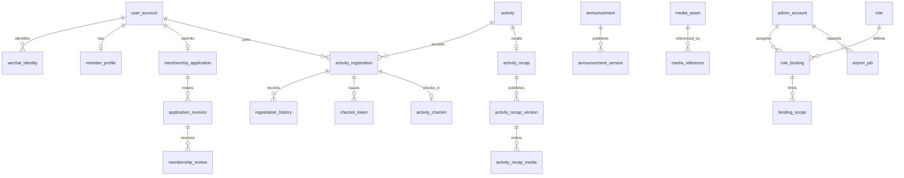

# 一期数据模型、状态与事务

版本：2026-09-22，开发设计基线。与 [总体架构](technical-architecture.md)、[接口契约](api-contracts.md)、[权限与文件](authorization-and-files.md)共同使用。本文定义实现约束；建表迁移和业务代码在用户决定启动后编写。

## 1. 通用约定

- MySQL 8.4 / InnoDB，`utf8mb4`；内部主键使用数据库生成的 `BIGINT`，API 中所有 ID 为十进制字符串，避免 JavaScript 精度丢失。存储键与公网凭证使用独立随机值，不使用递增 ID 当授权凭据。
- 时间存 UTC `DATETIME(3)`，连接会话时区固定 UTC；API 为带 `Z` 或偏移的 RFC 3339 字符串，入库统一转 UTC。输入/展示固定 `Asia/Shanghai`。服务端以数据库时间判断业务窗口，前端倒计时只用于提示。
- 可编辑聚合有 `version BIGINT`，修改时比较预期版本并递增；所有业务表有 `created_at`，可变表另有 `updated_at`。历史表只追加。长度校验按 Unicode 码点，必填文本去掉首尾空白后非空。
- 外键使用明确引用、默认限制删除；业务记录不级联删除。账号注销使用脱敏和保留稳定 ID 的方式处理历史。敏感文本字段保存密文与 `key_version`；手机号等值索引使用独立 HMAC 密钥，不用普通哈希。
- 字典使用稳定代码；家乡到甘肃区县、现居地到西安区县。区划表含父代码与祖先关系，数据库不接受任意字符串替代字典值。
- 同一次业务变更、对应历史和成功审计在同一事务提交；成功审计写入失败则业务回滚。失败/越权事件另用短事务记录脱敏结果。外部图片处理、文件生成、订阅消息不能放进业务事务。

## 2. 实体关系

图中省略了草稿、字典和系统运行表；具体约束以以下表格为准。

## 3. 表与关键约束

### 账号与成员

| 表 | 核心字段 | 约束/索引 |
| --- | --- | --- |
| `user_account` | id、status、auth_epoch、privacy_epoch、closure_requested_at、closed_at | 状态 ACTIVE / DISABLED / CLOSING / CLOSED；账号状态与成员资格分开；注销/删除资料递增 privacy_epoch，使旧文件快照失效 |
| `wechat_identity` | user_id、appid、openid | 唯一 `(appid, openid)`；不保存登录 code，不将手机号当主键 |
| `auth_session` | token_hash、subject_type、user_id 或 admin_id、auth_epoch、issued_at、expires_at、last_seen_at、revoked_at、mfa_at | token_hash 唯一；主体类型决定且仅有一个主体 FK 非空；索引主体/到期时间 |
| `member_profile` | user_id、qualification、name、phone_cipher、phone_hmac、phone_source、phone_verified_at、hometown_code、residence_code、industry_code、introduction、help_text、avatar_asset_id、directory_visible、phone_visible、version | user_id 唯一；qualification 为 NONE / ACTIVE / DISABLED / LEFT；phone_source 一期为 MANUAL，verified_at 为空 |
| `membership_application` | user_id、attempt_no、current_revision_id、status、version | user_id 唯一，一人一个聚合；每轮申请用 attempt_no 区分 |
| `application_revision` | application_id、attempt_no、revision_no、资料快照、协议版本、同意时间、submitted_at | 唯一 `(application_id, attempt_no, revision_no)`；提交后不可改；电话快照加密 |
| `membership_review` | revision_id、decision、public_reason、reviewer_id、reviewed_at | revision_id 唯一，每次提交只有一个审核结论；内部备注不放此表的公开字段 |
| `membership_history` | user_id、before/after、reason、actor_type/id、application_revision_id、created_at | 追加资格变更历史；停用/恢复/退出均记录 |
| `member_private_note` | user_id 或 application_id、note、author_id、version | 与公开资料分离；各类对象独立授权 |
| `member_tag / member_tag_link` | tag_id、user_id | 关联 `(tag_id,user_id)` 唯一 |
| `account_closure_job` | user_id、background_job_id、stage、checkpoint、error_code | user_id 唯一；租约由 background_job 管理；账号冻结后按活动逐个清理，可重启续做 |

名录查询索引从 `(qualification,directory_visible,id)` 起，家乡/现居/行业按实际过滤组合补充；申请列表索引 `(status,submitted_at,id)` 与当前修订的区域字段。手机号检索仅向有相应用途权限的后台提供完整号码等值查询。

### 活动与报名

| 表 | 核心字段 | 约束/索引 |
| --- | --- | --- |
| `activity` | title、summary、cover_asset_id、intro、place、owner_admin_id、visibility、publication_state、cancelled_at/reason、start_at/end_at、signup_open_at/close_at、cancel_close_at、checkin_open_at/close_at、capacity、companion_limit、occupied_count、version | publication_state 为 DRAFT / PUBLISHED；capacity > 0；0 ≤ occupied_count ≤ capacity；0 ≤ companion_limit ≤ 2 |
| `activity_draft` | activity_id、base_activity_version、完整编辑字段、draft_version、editor_id | activity_id 唯一；保存已发布活动的修改不改线上字段与计数 |
| `activity_change` | activity_id、before/after摘要、published_by、created_at | 发布、关键修改、取消记录，公开变更摘要不包含联系人 |
| `activity_registration` | activity_id、user_id、generation、status、companion_count、participant_count、contact_name、phone_cipher、phone_source、registered_at、cancelled_at/reason、version | 唯一 `(activity_id,user_id)`；participant_count = 1 + companion_count；状态 ACTIVE / CANCELLED / EVENT_CANCELLED |
| `registration_history` | registration_id、generation、动作、人数前后值、原因、操作者、时间 | 追加历史，保留每轮报名联系人快照的必要密文；不把签到作为报名取消 |
| `activity_checkin` | registration_id、generation、participant_count、operator_id、method、reason、checked_at | registration_id 唯一；签到人数为该报名当时总人数；签到后不再允许个人取消或重报 |
| `checkin_token` | token_hash、registration_id、generation、expires_at、revoked_at | token_hash 唯一；凭证同时绑定活动（由报名关系确定）与报名轮次 |

活动查询索引 `(publication_state,start_at,id)`；报名索引 `(activity_id,status,id)` 与 `(user_id,registered_at,id)`。`occupied_count` 等于 ACTIVE 报名人数之和，已签到且 ACTIVE 的报名仍占名额。展示有效报名份数为 ACTIVE 行数，签到人数从有效签到记录求和；整场取消后另展示历史签到人数，不能除以零个有效参加人。

### 内容与文件

| 表 | 核心字段 | 约束/索引 |
| --- | --- | --- |
| `announcement` | published_version_id、withdrawn_at、version | 当前发布指针与撤下状态是成员读取入口 |
| `announcement_draft` | announcement_id、base_version、draft_version、title、body、visibility、display_start/end、sort_order | announcement_id 唯一；草稿与线上独立 |
| `announcement_version` | announcement_id、version_no、全部发布字段、publisher_id、published_at | 唯一 `(announcement_id,version_no)`；快照不可改 |
| `activity_recap` | activity_id、published_version_id、withdrawn_at、version | activity_id 唯一 |
| `activity_recap_draft / activity_recap_version` | recap_id、标题正文、cover_asset_id、visibility、草稿版本或发布序号 | 回顾与公告相同发布模型；每个回顾一份服务器草稿，多人用版本保护 |
| `activity_recap_media` | draft_id 或 version_id、asset_id、position、caption | 恰有一个所有者字段非空；同一所有者内 asset_id 与 position 分别唯一，最多 30 项 |
| `media_asset / media_variant` | uploader、用途、状态、随机存储键、大小、真实类型、dimensions、key_version；衍生图规格 | 资产状态见文件方案；变体唯一 `(asset_id,variant)` |
| `media_reference` | asset_id、context_type、context_id、context_revision、reference_kind | 唯一引用关系；草稿、线上与保留历史分别记录，禁止清理被引用文件 |
| `media_access_ticket` | token_hash、subject、context、asset_id、variant、expires_at | 短时凭证不是公开对象存储链接；访问时重查上下文和主体权限 |

`published_version_id` 必须属于当前公告/回顾，不能引用别的聚合快照；迁移用组合唯一键与组合外键保证归属。草稿内容使用受限富文本结构（段落、文本、加粗、列表、链接），发布时转换成清洗后的渲染数据；外链仅允许 https，禁止脚本、iframe、内嵌任意样式与未经授权媒体引用。

### 管理与系统运行

| 表 | 核心字段 | 约束/索引 |
| --- | --- | --- |
| `admin_account / admin_totp / admin_recovery_code` | login_name、password_hash、status、auth_epoch；TOTP 加密密钥/last_used_step；恢复码摘要/used_at | login_name 规范化唯一；状态 INVITED / ACTIVE / DISABLED；秘密不出现在查询响应 |
| `admin_auth_challenge / admin_activation` | token_hash、admin_id、阶段、到期时间、尝试次数、consumed_at | 单次使用；待验证凭据无业务权限 |
| `role / role_permission / role_binding` | role_code、permission_code；admin_id/role_id | 预置角色定义动作集，绑定本身不自动授予全域数据 |
| `scope_set / scope_rule / binding_scope` | 作用域域名、类型、区划或活动集合；binding_id/domain/scope_set_id | 每个绑定在每个业务域最多一个 scope_set；无该域绑定则该域拒绝 |
| `admin_permission_grant` | admin_id、permission_code、scope_set_id | 独立授予电话、导出等附加权限，也受范围约束 |
| `security_guard` | 固定 id、revision | 管理员角色/范围/凭据状态修改的统一互斥行 |
| `feedback / feedback_history` | 类型、正文、关联对象、submitter、contact_consent、status、assignee、version；内部备注与对外回复分字段 | 待处理 OPEN → PROCESSING → RESOLVED / CLOSED；认领与结论带版本 |
| `audit_log` | actor、action、object、result、request_id、脱敏摘要、created_at | 追加；按操作者/对象/时间索引，无完整电话/令牌 |
| `export_job / export_manifest` | owner、scope/filter/field快照、auth_epoch、状态、attempt、文件、expires_at；结果资源ID及范围校验依据 | 创建请求唯一；清单与文件均私有；详细生命周期见文件方案 |
| `background_job` | type、aggregate_id/revision、state、available_at、attempt、lease_owner/until、lease_generation | 唯一业务任务键；claim 索引 `(state,available_at,id)`；结果提交校验租约代次 |
| `idempotency_record` | subject、operation、resource、key、request_hash、结果引用/安全响应、created_at/expires_at | 唯一 `(subject_type,subject_id,operation,resource,key)` |
| `login_attempt_bucket` | 主体摘要、来源摘要、window_start、count、blocked_until | 数据库原子限速；不记录密码、code 或 OTP |

导出和注销保留专用业务状态，调度可复用 `background_job`；同一任务不维护两套可独立变化的租约。字典、媒体元数据和运行表均不能作为普通后台自由编辑入口。

## 4. 状态与时间规则

### 申请、资格与退出

| 当前情况 | 操作 | 结果 |
| --- | --- | --- |
| 尚未申请，资格 NONE | 提交完整资料及协议版本 | 创建 PENDING 与修订 1 |
| PENDING | 通过 / 退回 / 拒绝 | APPROVED + 资格 ACTIVE / NEEDS_INFO / REJECTED |
| NEEDS_INFO | 申请人补充后重提 | 同轮 revision_no + 1，回到 PENDING，保留旧快照 |
| APPROVED / REJECTED | 重复审核 | STATE_CONFLICT，不覆盖历史 |
| REJECTED | 用户后续访问 | 保持结果与帮助反馈入口；一期不提供自动重申或后台直接改判 |
| 资格 ACTIVE | 管理员停用 | DISABLED；隐藏名录、禁止新报名；历史报名保留 |
| 资格 DISABLED | 授权管理员填写原因恢复 | ACTIVE；保留原申请通过记录 |
| ACTIVE / DISABLED | 本人退出社群 | LEFT；隐藏名录，不自动取消既有报名；确认页展示这一后果 |
| LEFT 且账号 ACTIVE | 本人重新申请 | attempt_no + 1，新的 PENDING；既有资格历史保留，通过才恢复 ACTIVE |

停用/退出后，只要账号仍 ACTIVE，用户可查看本人的历史报名、在规则允许时取消、为既有有效报名出示签到码；不能访问其他成员名录或新报名。账号 DISABLED 则禁止登录与任何私有接口，两者不能混用。

账号注销：本人重新完成微信登录确认后，立即把账号设为 CLOSING，撤销会话/签到码并隐藏公开资料。任务分批取消未结束活动中尚未签到的 ACTIVE 报名，使用 `ACCOUNT_CLOSURE` 系统原因释放名额；这是注销清理，不受普通取消截止限制。已签到或已结束活动保留去标识历史，不撤销签到。清除身份关联、电话及公开资料后置 CLOSED；再次微信登录将建立新的内部用户，不能继承旧资格。注销不要求用户联系管理员才可提交。

### 活动

- 生命周期只读计算：有 cancelled_at 为 CANCELLED；否则 `now < start_at` 为 UPCOMING，`start_at ≤ now < end_at` 为 ONGOING，`now ≥ end_at` 为 ENDED。DRAFT 是发布状态，不是生命周期。
- 报名窗口只读计算：未发布/取消/已结束均不可报名；`signup_open_at ≤ now < signup_close_at` 才在窗口内；是否满额独立返回，不把 FULL 当活动生命周期。
- 校验 `signup_open_at < signup_close_at ≤ start_at < end_at`，`cancel_close_at ≤ start_at`；普通取消要求 `now < cancel_close_at` 且未签到。展示窗口使用开始含、结束不含的一致规则。
- 签到默认从开始前 30 分钟到活动结束，即 `checkin_open_at = start_at - 30m`、`checkin_close_at = end_at`；与现有 09:30 活动、09:00 开放示例一致。数值为一期可配置技术默认值，落库以供核验；普通编辑跟随活动时间重算。
- 整场取消允许未开始或进行中的已发布活动，已结束活动不能普通取消或重开；回顾只能在未取消且已结束活动发布。
- 降低同行上限不得低于任何当前 ACTIVE 报名的同行数；降容量不得低于 occupied_count；发生签到后不能移动活动时间使既有签到落到新窗口外。关键修改预览展示差异，发布确认重新检查。
- 一期不提供直接修改已生效报名人数的接口；需要调整时在取消截止前取消并重新报名。代码保留人数历史，不为未来功能提前放开修改入口。

## 5. 事务与锁序

数据库隔离级别使用 READ COMMITTED，业务不依赖快照读取进行授权或名额判断。执行写入时使用锁定读与唯一约束，不能先在事务外校验再无条件更新。

统一顺序：需要权限保护时先对 `security_guard` 取共享锁（变更授权或新建活动并自分配范围时从开始即取排他锁，不从共享锁升级）→ 涉及账号/资格、签发或消费成员凭据时锁 `user_account`，需要资格时再锁 `member_profile` → 同一事务涉及的活动按 ID 升序 → 报名按 ID 升序 → 签到/令牌。申请审核在用户/资格之后锁申请聚合。不需要的层级可跳过，但不能反向补锁。整场活动取消仅锁活动及报名，不回头锁用户；成员退出不循环锁活动。跨模块由应用服务调用领域服务并共享同一数据库事务。

| 操作 | 事务内步骤与不变量 |
| --- | --- |
| 审核 | 获取当前权限与用户/申请锁，校验 PENDING、当前 revision/version 与申请快照范围；写唯一审核记录，更新申请和资格，写历史/审计；一起提交 |
| 报名 | 锁用户资格与活动，校验账号 ACTIVE、资格 ACTIVE、可见性及窗口；锁/创建报名；相同幂等请求返回原结果，新的重复报名返回 ALREADY_REGISTERED；计算本人+同行，原子增加 occupied_count 与保存联系人快照 |
| 重新报名 | 原记录必须 CANCELLED 且仍可报名；generation + 1，重新校验资料和容量；旧 generation 凭证永不复用；EVENT_CANCELLED 不允许重报 |
| 个人/管理员普通取消 | 锁活动与报名，核对版本、ACTIVE、未签到及截止；status → CANCELLED，仅此状态转换释放 participant_count，一起撤销令牌；重复同键返回原结果 |
| 整场取消 | 锁活动，在同一事务把其全部 ACTIVE 报名改 EVENT_CANCELLED、保留已签到历史、occupied_count → 0、撤销令牌，写原因/历史/审计；遇故障全部回滚；数据库批量写按报名 ID 排序 |
| 签到 | 预览只读；确认重新鉴权，先按凭据定位报名所属账号并锁账号检查未冻结，再锁活动/报名，检查 token 的 generation、活动、期限和状态；唯一插入 checkin；签到不减少 occupied_count；竞争失败读取已有签到时间/操作者 |
| 人工补签 | 同样活动/报名锁；要求额外权限、报名 ID、核对方式、原因；允许活动结束后补记，但必须是未取消活动的有效历史报名且确认时间不早于签到开放；记录实际补签时间，不伪造签到发生时间 |
| 活动发布/变更 | 锁活动与草稿，比较 draft_version、base_activity_version 和确认摘要；校验现有报名约束；将草稿复制到线上字段，version + 1，保存变更记录，计数由报名流程维护 |

整场取消与新报名由活动锁串行；取消与签到也由相同活动/报名锁串行。先签到成功后个人取消失败；先个人取消成功后签到失败。整场取消可保留此前已成功签到的历史，因此不同顺序可影响历史签到数，但最终都不再允许新的报名/签到。

报名状态不可用普通 PATCH 任意赋值。死锁/锁超时返回可重试错误；服务端最多对整个事务有限重试，并复用原幂等键。用户看见超时时由同键重试查询已提交结果，不提交第二份业务请求。

## 6. 内容发布事务

公告、活动回顾各维护一份可变服务器草稿及不可变发布快照。多人冲突以版本返回，前端保留当前内存输入供比较；敏感资料不落浏览器持久化草稿。

保存草稿只比较 draft_version 并递增，不修改线上指针。发布时锁内容聚合和草稿，检查 base_version、预期草稿版本、字段与媒体 READY 状态，建立不可变快照和媒体引用，再一次性切换 published_version_id、清除 withdrawn_at、递增聚合版本，并把草稿基线更新到该版本。回顾发布在内容锁之前先锁所属活动；图片 READY 后不可就地替换，重新上传使用新 asset_id。

撤下时比较聚合版本并设置 withdrawn_at，保留发布历史与草稿；详情和图片网关都以撤下状态拒绝后续新请求。公告展示时间、排序与可见性来自同一个已发布快照：未到 display_start 不向成员端公开；到期后仅退出首页，详情仍可访问；撤下或无权限则详情不可用。回顾访问范围取发布快照范围与活动当前范围的交集，不能随编辑自动扩大。

失败回滚后线上版本、图片计数和封面均不变。删除草稿照片只移除草稿引用；仍被线上/历史引用的资产保留，文件回收按 [文件生命周期](authorization-and-files.md)执行。

## 7. 幂等与验收输入

关键创建、审核、发布、取消、签到、权限调整与导出写操作要求 `Idempotency-Key`；作用域为主体 + 操作 + 资源。规范化请求摘要包含预期版本和业务字段，不包含会话令牌。幂等记录与业务变更同事务提交；同键异参返回 409，不以新请求覆盖。

记录默认保留 7 天，只存安全响应或业务结果引用；重放也先验当前身份/权限。重放历史“报名成功”结果须标记 `replayed=true`，客户端随后读取报名最新状态，不能据旧响应把已经取消的报名变回有效。超过保留期依靠预期版本、报名 expectedGeneration、状态和数据库唯一约束防重，不能盲目再次执行非幂等动作。各类版本控制更新只有成功提交才递增，预览操作不递增业务版本。

开发测试至少覆盖：两个审核人同时处理同一修订；100 个并发请求争抢有限名额；个人取消与签到同时发生；取消后重报再使用旧码；整场取消与新报名竞争；发布失败回滚；草稿修改不影响线上；退出与新报名竞争；注销任务中断重启；最后一位超级管理员并发降权。此清单是后续实现验收标准，本轮不宣称这些测试已运行。
