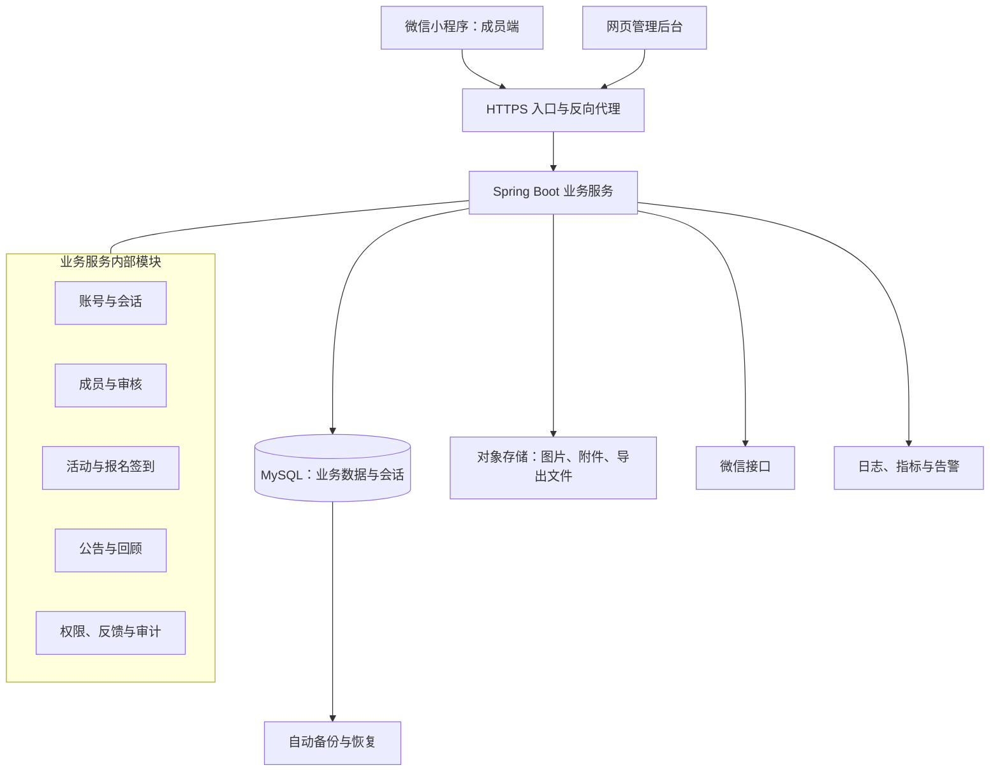

# 西引力.陇聚 技术架构方案

状态：一期开发设计基线已补齐，等待用户决定是否开始编码。初稿：2026-09-19；更新：2026-09-22。

## 阅读入口与当前结论

现有技术方向可以沿用。本轮已将两端一期需求补充为数据、接口、权限和交付设计，关键架构问题已闭环，具备进入编码阶段的设计条件；应用实现、实际接入、压测与上线验收尚未执行。用户当前只需决定是否开始编码，不需要承担以下技术文档的编写或细节选择。

| 设计材料 | 定义内容 |
| --- | --- |
| [数据模型、状态与事务](data-model-and-transactions.md) | 实体关系、主键/唯一约束、状态与时间、审核/报名/取消/签到事务、草稿发布 |
| [关键接口契约](api-contracts.md) | 两端请求/响应、分页、版本冲突、幂等、核心字段与错误码 |
| [权限、文件与后台任务](authorization-and-files.md) | 角色和数据范围、敏感字段、媒体网关、导出撤权、租约与清理 |
| [身份接入、工程与交付](identity-and-delivery.md) | 微信登录、管理员激活/TOTP/恢复、工程选型、环境与验收责任 |
| [架构评审闭环](technical-architecture-review.md) | 原六项缺口的处理依据与进入编码的结论 |

上述文档与本文件组成同一基线。业务范围以当前小程序、后台和活动回顾需求为准；详细字段、锁序和接口语义以下列专项设计为准。草稿、未来商城规划和历史设计记录不覆盖当前基线。

## 1. 范围与设计假设

- 服务在西安的甘肃人，潜在成员约 1 万人；成员总量不等于同时在线人数。
- 一期交付微信小程序、网页管理后台和业务服务，支持加入审核、成员名录、公告、活动报名、签到、反馈和权限管理。
- 二期建设自营甘肃特产商城，一期不建设商品、订单、支付或退款系统，也不展示商城入口。
- 默认只建设微信端；暂未提出 App、多组织平台、聊天或自由发帖需求。
- 暂按小团队持续维护、单地域部署设计。团队已有技术经验、预算和可用性要求确认后，可调整实现选型。
- 一期活动暂按不接在线支付设计；如有线下收费，仅记录人工确认的缴费状态，不将其视为支付流水。

## 2. 架构总览

采用前后端分离的模块化单体：代码按业务拆分，后端统一构建和部署，事务在同一数据库内完成。



一期无需微服务、服务注册中心、消息队列、搜索集群或 Kubernetes。Redis 暂不作为必要依赖；需要多实例共享限流、高频会话访问或热点缓存时再增加。

## 3. 技术栈建议

| 层次 | 建议 | 用途与理由 |
| --- | --- | --- |
| 微信小程序 | 原生小程序 + TypeScript | 现阶段仅面向微信，直接接入登录、分享、扫码等能力 |
| 管理后台 | Vue 3 + TypeScript + Vite | 构建审核、成员查询、活动和权限管理页面 |
| 服务端 | Java 21 + Spring Boot 4.1.1 + Spring Security | 组织业务逻辑、事务和统一权限校验，Security 跟随 Boot BOM |
| 数据访问 | MyBatis Starter 4.0.0 + Flyway | 显式控制报名事务和 SQL，Flyway 及 MySQL 支持模块按 Boot BOM 对齐 |
| 数据库 | MySQL 8.4 / InnoDB | 保存成员、报名、审核和审计数据 |
| 文件 | S3 兼容对象存储或云厂商对象存储 SDK | 存放图片和文件，避免应用本地磁盘成为数据依赖 |
| 接口 | HTTPS + REST JSON + OpenAPI | 小程序与后台共用业务能力，分开接口权限 |
| 交付 | Docker 镜像 + 自动构建发布 | 统一运行环境，支持回滚 |

本轮已读取 Spring Boot 与 MyBatis 官方兼容说明，选择上表作为工程初始基准。建立项目时复核安全补丁、锁定完整依赖与工具版本并执行最小构建；不把文档兼容关系当作已经构建通过的证据。来源与前端 Node 环境选择见 [工程选型](identity-and-delivery.md)。

Vue 3 适用于单页后台，使用其 TypeScript 和组件化能力：[Vue 官方介绍](https://vuejs.org/guide/introduction.html)。上述选型是本项目建议，不代表已经建立或验证依赖组合。

## 4. 模块职责

| 模块 | 一期负责的能力 | 边界 |
| --- | --- | --- |
| identity | 微信账号关联、管理员登录、会话、禁用与注销 | 登录账号与会员资格独立 |
| membership | 加入社群申请、审核、成员档案、标签、名录隐私 | 管理员备注与公开资料分离 |
| activity | 活动发布、报名、取消、人数统计、核销 | 统一负责名额和报名状态变更 |
| publishing | 组织介绍、公告、首页推荐、活动回顾 | 区分公开内容与仅成员可见内容 |
| media | 上传授权、文件元数据、访问控制 | 私有文件不可通过固定公开链接访问 |
| feedback | 意见反馈、举报与处理记录 | 仅授权工作人员可处理 |
| administration | 管理角色、数据范围、审计、统计与导出 | 导出权限单独授权 |

每个模块包含接口、业务逻辑和数据访问代码。跨模块通过服务接口调用，避免一个模块直接修改另一个模块的数据表。

## 5. 账号、资格与隐私

微信登录设计链路：客户端获取临时 code → 服务端向微信换取身份 → 按 appid + openid 关联内部 user_id → 签发本系统随机会话令牌。

- 小程序端提交的 openid、user_id 或角色不能作为身份凭据。
- 微信密钥、session_key 留在服务端；不得写入小程序包或日志。
- 一期采用可撤销的随机会话令牌；数据库保存令牌摘要、主体、终端类型、过期时间和撤销状态。
- 小程序使用 Bearer 令牌；管理员后台使用 HttpOnly、Secure Cookie，配合 CSRF 防护。后台静态页面与后台 API 尽量同源。
- 管理员使用独立账号与角色，密码采用 Argon2id；高权限账号采用 TOTP 第二因素验证，包含首次激活、恢复码与受控部署恢复流程。登录失败数据库限速。
- 每次受限请求在服务端检查当前账号状态及该资源要求的资格/权限，禁用或撤销权限及时生效。成员资格停用与账号禁用分开；停用/退出成员仍可管理本人既有报名，新报名和名录访问被禁止。
- 登录成功不等于审核通过；申请状态包括待审核、需补充、通过、拒绝，成员资格单独维护。
- 普通成员、成员管理员、活动运营、超级管理员使用不同权限；分组负责人额外受数据范围约束。
- 电话不得向其他成员公开，成员端名录列表与详情均不返回电话号码；名录资料可由本人设置是否向有效成员展示。列表与详情接口都由服务端裁剪字段，不能先返回给前端再隐藏。
- 管理员内部备注独立存放，不进入成员端响应；名录强制分页并限制查询频率和单页数量。
- 提供退出组织、删除公开资料和账号注销入口。注销先冻结账号和撤销会话，再以可恢复任务处理未结束报名、资料与照片；历史记录去标识。工程保留默认值及备份恢复后的清理规则见 [权限与文件](authorization-and-files.md)，最终生产参数与实际隐私说明保持一致。
- 电话加密存储；确需等值检索时维护使用独立密钥的 HMAC 索引，密钥与数据库分开保管。

2026-09-22 已读取微信官方登录、网络与图片预览文档，明确 code2Session、自建会话、HTTPS 合法域名及图片 URL 方案。目标小程序主体、AppID、隐私授权配置和真机能力在接入阶段验证；官方文档核对不等于已完成实际接入。

## 6. 核心数据结构

| 表或表组 | 关键内容 |
| --- | --- |
| user_account / wechat_identity / auth_session | 内部用户、appid + openid 唯一关联、会话 |
| member_profile / member_private_note | 姓名、家乡、区域、行业、资格、公开配置；内部备注单独维护 |
| membership_application / application_revision / membership_review / membership_history | 分轮申请、不可变资料修订、审核结论与独立资格历史 |
| member_tag / member_tag_link | 标签及成员关联 |
| activity / activity_draft / activity_change | 线上活动、独立编辑草稿、变更记录；发布状态与按时间计算的生命周期分开 |
| activity_registration | 活动、用户、报名 generation、实际参加人数、状态、报名时的必要联系信息 |
| registration_history / activity_checkin / checkin_token | 分轮报名历史、唯一有效签到与有时效且绑定轮次的凭据 |
| announcement / announcement_draft / announcement_version | 公告聚合、草稿与不可变发布快照 |
| activity_recap / activity_recap_draft | 活动回顾聚合、独立编辑草稿及当前发布指针 |
| activity_recap_version / activity_recap_media | 已发布回顾快照、图片顺序、图片说明与封面引用；草稿与线上版本隔离 |
| media_asset | 存储键、所有者、用途、可见性、文件状态 |
| admin_account / role / role_permission / role_binding / binding_scope / admin_permission_grant | 管理员动作、数据范围与额外敏感权限；普通会员身份不自动赋予管理权 |
| feedback / audit_log / export_job | 反馈、关键操作记录、导出任务和文件有效期 |
| region / industry | 行政区划与行业字典，以稳定代码关联 |

关键约束：wechat_identity(appid, openid) 唯一；activity_registration(activity_id, user_id) 唯一；每份报名最多一条有效签到记录。取消后重新报名更新原报名记录并增加 generation，保存变更历史，旧码不可用于新一轮报名。完整字段、运行表和外键约束见 [数据模型](data-model-and-transactions.md)。

索引按实际查询建设：会员资格与名录可见性、家乡/西安区域/行业组合筛选，活动状态与开始时间，报名的活动与状态。姓名包含搜索在万级数据上先用数据库实现并测量耗时，不提前加入搜索引擎。

成员和未来消费者共用稳定的 user_id。加入社群申请资料变化、活动联系人快照和账号注销要分别处理，不用手机号作为业务主键。

## 7. 防止报名超员与重复核销

报名名额以 MySQL 为唯一事实来源，不以页面剩余人数或缓存判断最终结果。

1. 开启数据库事务，按需先锁当前授权、用户/成员资格，再锁活动；校验当前资格、发布状态、报名窗口及人数上限。
2. 查询/锁定该成员的报名记录，同幂等键重试返回已有结果，新请求重复报名返回明确业务冲突；参加人数由服务端计算为本人加同行人数。
3. 确认剩余名额足够，在同一事务中修改占用人数与报名记录，失败整体回滚。
4. 取消、修改携带人数、管理员调整名额统一按“活动行 → 报名行”的顺序加锁，避免并发扣减或重复释放。
5. 签到使用 120 秒随机码，绑定报名、活动和 generation，由具备该活动核销权限的人员扫码预览并确认；确认时重新校验状态和窗口，在相同活动/报名锁下唯一写入签到记录。
6. 管理员手动补签需要独立权限、报名 ID、核对方式和原因。普通取消必须在截止前且未签到；整场活动取消原子更新活动及所有有效报名、名额和令牌，同时保留历史签到。

审核、成员退出/注销、活动发布和内容发布也已定义事务边界。全局锁序、冲突优先级与具体窗口见 [状态与事务](data-model-and-transactions.md)，不能只实现报名加锁而忽略取消、签到与权限变更。

上述事务方案利用 InnoDB 锁定读保护并发修改：[MySQL 锁定读官方文档](https://dev.mysql.com/doc/refman/8.4/en/innodb-locking-reads.html)。

## 8. 接口与文件处理

- 成员端接口前缀 `/api/v1/app`，后台接口前缀 `/api/v1/admin`；分前缀不能替代鉴权。
- [接口契约](api-contracts.md)统一描述字段、分页、状态枚举、If-Match 与 Idempotency-Key；错误包含 requestId，便于定位问题。
- 从会话获取当前用户；查看他人报名、核销和后台资料时都校验资源归属或数据权限。
- 创建报名等写操作支持幂等，数据库唯一约束负责最终兜底。
- 上传凭证限定文件类型、大小、用途和短有效期，服务端确认文件属性后再标记可用；限制批量上传数量。
- 活动图片通过绑定发布上下文的媒体网关访问，逐次检查权限与发布状态；导出文件始终私有，由业务服务逐次鉴权并传输，不向浏览器发可绕过撤权的存储签名下载链接。
- HTML 内容做清洗，表格导出防公式注入，普通日志不记录完整手机号、令牌或上传凭证。
- 一期导出任务持久化到数据库，由后台任务执行；服务重启可重试，无需先引入消息队列。
- 结果与活动变更以小程序站内状态为准；订阅消息属于可选增强，需结合用户授权和可用模板验证，不承诺必达。

活动结束后的图片上传、图文回顾及发布规则来自 [活动回顾需求](activity-recap.md)。公告与回顾均使用独立草稿、不可变发布快照和原子切换指针；小程序仅返回有权查看的线上版本。图片封面、顺序和计数随版本一并发布。任务租约、清理和导出撤权细节见 [权限、文件与后台任务](authorization-and-files.md)。

## 9. 部署、可用性与运维

一期试运营建议：一台 2–4 vCPU / 4–8 GB 应用服务器部署反向代理和应用容器，数据库使用独立托管 MySQL，图片使用对象存储。规格只是压测起点，不是容量保证；厂商、实例和费用根据部署地域与预算选定。

- 数据库放私网，仅允许业务服务和受控维护通道访问。
- 区分开发、测试、生产环境；数据库、存储、配置与账号凭据隔离，测试不复制未脱敏成员资料。
- 管理后台静态文件独立构建；应用配置与密钥通过环境注入或密钥服务提供，不进入代码仓库。
- 监控接口耗时、错误率、数据库连接、磁盘空间、备份结果、导出失败以及报名异常。
- 数据库自动备份并开启支持时间点恢复的日志保留，文件开启适当版本保留；上线前进行一次完整恢复演练。
- 建议恢复目标：RPO 不超过 15 分钟、RTO 不超过 4 小时。目标需由选定云服务能力及恢复演练验证。
- 单应用实例存在服务中断风险，维护发布会有短暂影响；若正式运营要求单机故障不中断，采用负载均衡 + 双应用实例，并选择数据库高可用方案。
- 多实例时统一会话、限流和后台任务租约；数据库约束继续保障报名一致性。
- 小程序主体、服务类目、域名配置与所需上线手续由运营方按发布时平台要求核验。本方案不假设这些准备已经完成。

## 10. 工程交付与验证

按用户确认，三个项目分别建立独立 Git 仓库，统一放在 `/Users/steven/Documents/GitRespositories/longju`。父目录只作本地组织目录，不建立第四个 Git 仓库，也不使用 Git 子模块。

```text
/Users/steven/Documents/GitRespositories/longju/
  README.md              本地项目入口
  longju-miniapp/        独立仓库：原生微信小程序
  longju-admin/          独立仓库：Vue 管理后台
  longju-api/            独立仓库：Spring Boot 业务服务
    docs/               需求与架构开发基线
    contracts/          后续编码时建立 OpenAPI 契约
    deploy/             后续编码时建立服务部署说明和配置
```

各仓库独立维护依赖、锁文件、测试、构建与发布；两个前端不通过相对路径导入另一个仓库的源代码。OpenAPI 的唯一维护源位于后端仓库，前端按明确发布版本获取契约并生成/验证自身类型，不能依赖同机旁边仓库的未提交文件。跨端兼容变更先发布后端，再发布客户端；破坏性变更另行提供兼容接口或新 API 版本。

各仓库提交后执行相应类型检查、构建与关键业务测试，后端发布不可变镜像。数据库变更纳入 Flyway 管理，优先使用向后兼容的新增字段/表；应用回滚与数据库回退分别制定方案。统一入口与部署仍遵守后台页面和管理 API 同源的约定，代码分仓不改变权限、事务与运行时接口边界。

必要验证覆盖：会员审核与权限、隐私字段裁剪、活动报名并发、重复请求、取消释放人数、签到重放、导出权限与备份恢复。

压测以 1 万成员数据和实际活动数据分布为基础。暂定测试场景为 100 个并发活跃请求，以及同一活动 100 个并发报名请求；这是测试起点，不是已有流量预测。核心验收是零超员、零重复有效报名、零重复释放名额；普通查询暂以服务端 P95 小于 500ms 为优化目标，最终门槛按环境和实际峰值调整。

## 11. 二期商城扩展

增加 catalog（商品/规格）、inventory（库存）、order（订单）、payment（支付退款）、fulfillment（发货售后）模块，初期仍可在同一业务服务内部署。

复用一期账号、权限、文件能力与审计。商城维护独立的收货地址、订单快照和库存流水；成员资格失效不删除历史订单。是否仅成员可购买作为业务规则单独确认。

支付回调验签、金额核对、幂等处理、库存占用释放、超时关单和交易对账在二期专项设计；一期不提前建立空商城表或接入支付。

## 12. 建议实施顺序

1. 建立工程、数据库迁移、登录会话、角色权限、文件和部署基础。
2. 完成加入社群申请、审核、成员档案、名录和隐私设置。
3. 完成活动发布、报名取消、签到、公告与回顾。
4. 完成后台统计、反馈、审计、导出与恢复演练，执行关键并发测试并小范围试运营。

本文件为架构设计成果。2026-09-22 已完成编码前详细设计与交叉核对，下一步等待用户决定是否启动上述实施顺序；尚未建立应用工程，不包含已运行的系统、容量测试结果或采购承诺。

## 2026-09-21 一期范围补充

对外组织称谓统一为「老乡社群」，操作为「申请加入」。内部 membership 模块、稳定标识与审核权限保持原有含义。首页公告位于加入卡片之前，无公告时隐藏并收起间距；详情返回保留原身份和审核状态。

一期底部仅首页、老乡录、活动、我的四项，不提供产品菜单或「敬请期待」占位页，不开放产品路由。二期产品模块仅保留扩展规划，实际开放前另行确定业务内容、入口名称与交易履约方案。当前需求基线见 `community-phase-one.md`。
